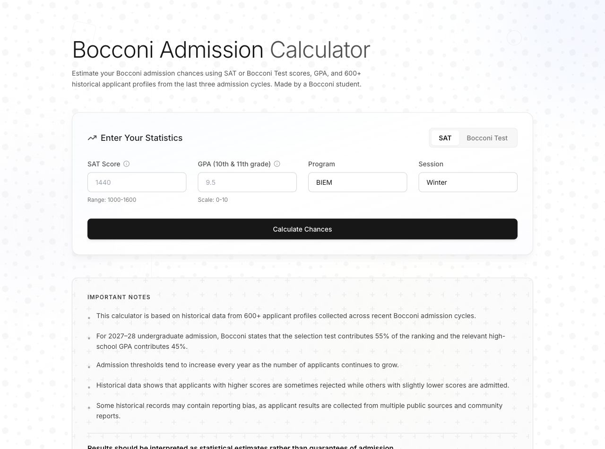
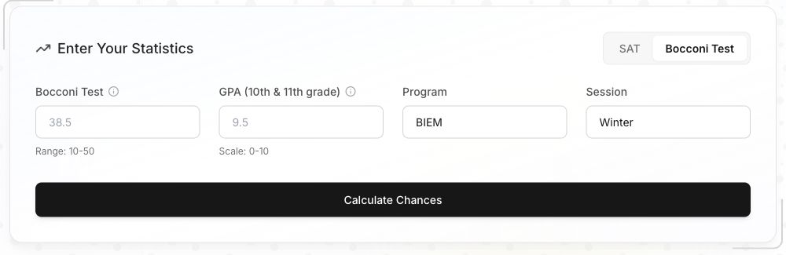

# Chance Me

A Bocconi admissions calculator that compares test scores and GPA with self-reported historical application records.

[Try it at chance-me.com](https://chance-me.com).

<table>
  <tr>
    <td><a href="docs/readme/homepage.jpg"></a></td>
    <td><a href="docs/readme/calculator.jpg"></a></td>
  </tr>
</table>

*The current public website. Click either screenshot for the full-size image.*

## Why I built it

I study at Bocconi, and built Chance Me to help applicants put their scores in context. An official minimum tells you whether you can apply; it does not tell you how your profile compares with people who applied before.

The calculator brings that comparison into one place. A user chooses their test, enters their score and GPA, and selects a program and application round. The backend compares those inputs with the historical records and returns an estimate with context.

I first built the product in March 2026 and have continued working on its methodology, search visibility and presentation. Vercel Web Analytics recorded **1,206 visitors between September 18 and October 18, 2026**. That is a dated traffic result, not a count of completed calculations or admissions outcomes.

## How it works

The frontend is plain HTML, CSS and JavaScript. A Flask API in Python handles the calculation. Both are deployed on Vercel, with the API exposed through serverless routes.

```text
Calculator form
      |
POST /api/calculate
      |
Input validation + historical comparisons
      |
Result, context and next steps
```

The production repository includes two historical input files: 520 SAT records and 143 Bocconi Test records. Those are **663 rows of self-reported data**, with possible repeated applicants and uneven coverage. They are not 663 verified independent people or official university admissions data.

The current production calculation uses hand-built heuristics and historical comparisons. An earlier README called it KNN; that was an inaccurate description of the deployed implementation. Experimental models developed separately are not automatically the model running on the website.

## What I worked on beyond the calculator

People also arrive with questions about the SAT and Bocconi Test. I added separate guides for those topics, with their own titles, descriptions, canonical links and structured data. The homepage, guides, sitemap and internal links are kept consistent rather than treating SEO as a list of keywords.

The site includes product events for starting, submitting and completing a calculation. Those events use coarse dimensions such as test type and result band; they intentionally exclude raw scores and GPA. This makes it possible to study the flow without sending those inputs as analytics event parameters.

## A few decisions that matter

**A minimum and an estimate answer different questions.** Official eligibility rules, historical observations and a model's estimate need to stay distinguishable. A percentage is not an official Bocconi decision or a guarantee.

**More rows do not necessarily mean better evidence.** Self-reported data can contain duplicates, missing context and selection bias. A result based on a thin slice of that data should not carry the same apparent certainty as a well-supported comparison.

**Input validation belongs in the API.** The frontend helps users enter a profile, but the server also checks malformed requests and unsupported inputs. Regression tests cover the API and the site's SEO contracts.

**Keep the frontend small.** The calculator does not need a large client-side framework. Static pages and a focused Python endpoint keep the deployment and request flow straightforward.

## Built with

- **Python and Flask** for the calculation API and historical comparisons.
- **HTML, CSS and vanilla JavaScript** for the calculator and guides.
- **Vercel** for static hosting and serverless API routes.
- **Vercel Web Analytics, GA4 and Microsoft Clarity** for the site's current measurement setup.
- **Python unittest and GitHub Actions** for regression checks.

## Running it locally

```bash
python3 -m venv .venv
.venv/bin/python -m pip install -r api/requirements.txt
.venv/bin/python -m unittest discover -s tests -v
.venv/bin/python api/index.py
```

The Flask server exposes `/api/calculate` and `/api/health`. To test the complete frontend locally, serve the repository root and proxy `/api` to Flask, or use a configured Vercel development environment.

The static guides live at `/bocconi-sat-score/` and `/bocconi-test-score/`. This repository contains the current public implementation; changes to the admissions methodology need their own validation before release.

Chance Me is an independent project and is not affiliated with Bocconi University.


## Active Campus implementation

The 2026-10-27 release moves the authored site to `src/`, the portable frozen model to `lib/engine/`, and the deployable static output to generated `public/`. The older root HTML/CSV are historical and are not the published application. Follow [the engineering contract](AGENTS.md) for commands and [the production release notes](docs/PRODUCTION-RELEASE.md) for privacy, model provenance, SEO and rollback.
